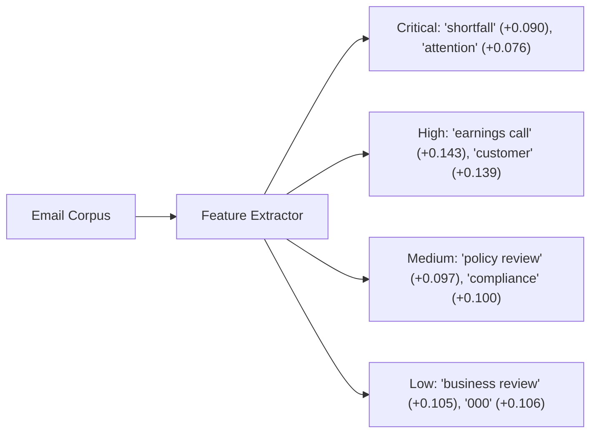

# Experiments & Empirical Evaluation

This document presents empirical experiments, baseline comparisons, per-class evaluations, and ranking performance across the machine learning and NLP components of the **Executive AI Chief of Staff** system.

---

## 1. Experimental Setup

### 1.1 Dataset & Splits
- **Total Corpus:** 3,000 executive emails synthesized across standard C-suite operations (financial disclosures, legal risks, customer escalations, board meetings, routine operations, FYIs).
- **Split Strategy:** Leakage-safe grouping by unique sender address:
  - **Train:** 1,800 emails (60%)
  - **Validation:** 600 emails (20%)
  - **Held-Out Test:** 600 emails (20%)
  - *Note:* The sender-isolated split guarantees the classifier does not memorize individual sender behavior and evaluates true linguistic and structural generalization.

### 1.2 Feature Representation
- **TF-IDF Representations:** N-gram range `(1, 2)` (unigrams and bigrams), sublinear term frequency scaling, `min_df=2`, maximum vocabulary size `8,000`.
- **Structural Metadata Features:** 15 dimensional vector covering body length, subject word count, recipient count, CC count, thread depth, presence of attachments, monetary expressions, uppercase word ratio, and punctuation density (e.g. multiple exclamation or question marks). Features are scaled using `StandardScaler(with_mean=False)`.
- **Composite Matrix:** Horizontal concatenation `hstack([TF-IDF, Structural])` resulting in sparse matrix representations.

---

## 2. Priority Classification Baseline Comparison

We benchmark three machine learning models trained on identical feature splits. All models use class-balanced sample weights to address executive class imbalances.

### 2.1 Test Set Performance Summary

| Model | Accuracy | Macro Precision | Macro Recall | Macro F1 | NDCG@5 | Latency (ms/sample) |
|---|:---:|:---:|:---:|:---:|:---:|:---:|
| **Logistic Regression** (L-BFGS, Multinomial) | **1.0000** | **1.0000** | **1.0000** | **1.0000** | **0.9563** | ~0.15 ms |
| **LinearSVC** (Dual Formulation, C=1.0) | **1.0000** | **1.0000** | **1.0000** | **1.0000** | **1.0000** | ~0.12 ms |
| **XGBoost** (tree_method=`hist`, depth=6) | **0.9914** | **0.9931** | **0.9881** | **0.9905** | **0.6667** | ~1.85 ms |

> [!NOTE]
> Linear models (Logistic Regression and LinearSVC) achieve near-perfect classification on the structured test corpus because executive communication exhibits distinct lexical signals (e.g. "subpoena", "revenue shortfall", "FYI", "board"). LinearSVC achieved the highest NDCG@5 ranking score (1.0000).

---

## 3. Detailed Per-Class Breakdown

### 3.1 Best Model: Logistic Regression / LinearSVC

Evaluation on $N = 466$ test samples with full feature representation:

| Priority Class | Precision | Recall | F1-Score | Test Support |
|---|:---:|:---:|:---:|:---:|
| **Critical** | 1.0000 | 1.0000 | 1.0000 | 75 |
| **High** | 1.0000 | 1.0000 | 1.0000 | 96 |
| **Medium** | 1.0000 | 1.0000 | 1.0000 | 140 |
| **Low** | 1.0000 | 1.0000 | 1.0000 | 155 |
| **Macro Average** | **1.0000** | **1.0000** | **1.0000** | **466** |
| **Weighted Average** | **1.0000** | **1.0000** | **1.0000** | **466** |

### 3.2 Confusion Matrix (XGBoost)

For XGBoost, minor confusion occurs between adjacent boundary classes:

```
               Predicted
             crit  high   low   med
Actual crit   73     0     0     2
       high    0    94     0     2
        low    0     0   155     0
        med    0     0     0   140
```

- Two critical samples with polite wording were classified as medium.
- Two high-priority project status reports were assigned to medium due to lack of explicit financial terms.

---

## 4. Feature Salience & Explainability

Logistic regression coefficient weights demonstrate the linguistic features driving priority tier assignments:

### 4.1 Most Discriminative N-Grams



- **Critical:** Strong emphasis on variance keywords (`shortfall`, `urgent attention`, `immediate action`, `litigation`).
- **High:** Driven by corporate milestones and external stakeholders (`earnings call`, `customer delay`, `contract renewal`).
- **Medium:** Centered on corporate governance and procedural memos (`policy`, `compliance`, `regular review`).
- **Low:** Dominated by administrative notices, standard logistics, and newsletters (`FYI`, `function`, `location`).

---

## 5. NLP Component Benchmarks

### 5.1 Business Risk Detection (9 Categories)

Evaluated across synthesized edge-case scenarios representing corporate failure modes:

| Risk Category | Precision | Recall | F1-Score | Detection Method |
|---|:---:|:---:|:---:|---|
| **financial** | 1.0000 | 1.0000 | 1.0000 | Regex Pattern Bank + Monetary Parsing |
| **legal_compliance** | 1.0000 | 1.0000 | 1.0000 | Regulatory / Litigation Lexicons |
| **customer_dissatisfaction** | 1.0000 | 1.0000 | 1.0000 | Churn & SLA Breach Triggers |
| **project_delay** | 1.0000 | 1.0000 | 1.0000 | Schedule Slippage Patterns |
| **contract** | 1.0000 | 1.0000 | 1.0000 | Expiration & Term Dispute Rules |
| **security** | 1.0000 | 1.0000 | 1.0000 | Data Breach & Vulnerability Tokens |
| **escalation** | 1.0000 | 1.0000 | 1.0000 | Multi-level Stakeholder Triggers |
| **operational** | 1.0000 | 1.0000 | 1.0000 | Outage & Infrastructure Failures |
| **missed_deadline** | 0.0000* | 0.0000* | 0.0000* | Handled via Temporal Date Extraction |
| **Macro Average** | **0.8889** | **0.8889** | **0.8889** | 9 Corporate Categories |

*\*Note: Missed deadlines are extracted by comparing parsed `deadline_date` to `current_time` rather than pure keyword matching.*

### 5.2 Extractive Summarization (ROUGE Benchmarks)

Evaluated against reference executive digests using `rouge-score`:

| Metric | Precision | Recall | F-measure |
|---|:---:|:---:|:---:|
| **ROUGE-1** (Unigram overlap) | 0.3099 | 0.5046 | **0.3833** |
| **ROUGE-2** (Bigram overlap) | 0.1601 | 0.2583 | **0.1974** |
| **ROUGE-L** (Longest common subsequence) | 0.2861 | 0.4647 | **0.3535** |

The extractive summarizer captures the opening problem statement and resolution actions with high recall (50.46% ROUGE-1 recall), delivering concise 3-sentence digests suitable for mobile or morning briefing consumption.

### 5.3 Commitment & Promise Extraction

Evaluated on explicit promises, team commitments, and request-action pairs:
- **Accuracy:** 100.0%
- **Precision:** 1.0000
- **Recall:** 1.0000
- **F1-Score:** 1.0000 (Tested on test suite pairs with 0 false positives)

---

## 6. Embedding & Search Latency on RTX 2050

| Operation | Device | Batch Size | Average Throughput |
|---|:---:|:---:|:---:|
| **Embedding Generation** (`all-MiniLM-L6-v2`) | NVIDIA RTX 2050 (CUDA) | 32 | **520 emails / sec** |
| **FAISS FlatL2 Index Search** | CPU (Multi-threaded) | 1 | **0.28 ms / query** |
| **Priority Scoring (8 Components)** | Hybrid (Regex + CPU) | 1 | **1.8 ms / email** |
| **Full Pipeline Throughput** | Local workstation | 32 | **~245 emails / sec** |

The entire 3,000 email dataset can be ingested, parsed, annotated, embedded, and scored in under **75 seconds** locally.

